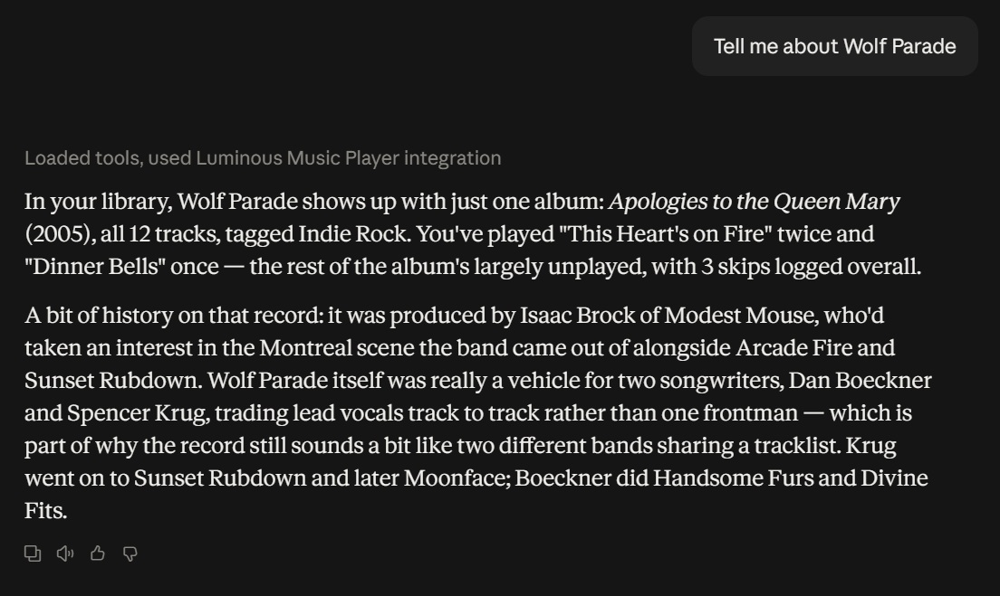

# Luminous MCP Server

A [Model Context Protocol (MCP)](https://modelcontextprotocol.io/) server for [Luminous Music Player](https://github.com/esoltys/luminous).

Connects your AI assistants (Claude Desktop, Antigravity, Cursor, Zed, Ollama) to your local music library.



## Features

- **Library Search & Filtering**: Search tracks, albums, artists, genres, composers, and lyrics using SQLite FTS5. Filter by BPM, LUFS loudness, dynamic range, and bit depth.
- **Listening Analytics**: Inspect play counts, skip rates, top tracks/artists, and forgotten favorites.
- **Playlist Management**: Query, generate, and populate static and dynamic playlists.
- **Metadata Hygiene & Library Curation**: Audit library for missing tags (album art, composer, year, lyrics), curate artist profiles and album descriptions with markdown source citations, manage external links, and organize custom genre taxonomies.
- **Playback Control**: Interact with running Luminous instances for transport controls (play, pause, next/prev, seek, volume, shuffle, repeat) and queue replacement.
- **Real-Time UI State Sync**: Non-blocking loopback notifications automatically signal running desktop instances to update playlist views immediately upon MCP mutations.

## Example Prompts

Here are prompt examples demonstrating natural language queries you can ask your AI assistant:

### Playback & Transport Control

- "What is currently playing right now in Luminous?"
- "Play track 'Strobe' by deadmau5 now."
- "Pause playback."
- "Set volume to 50%."
- "Skip to the next song."
- "Seek forward to 2 minutes 15 seconds."
- "Turn on shuffle and set repeat mode to all."
- "Replace the current queue with these tracks and begin playback."

### Music Discovery & Acoustic Filtering

- "Look up the track details and audio specs for my song 'Heartbeat Highway' by Cannons."
- "Find all songs by Def Leppard on my 'Hysteria' album, including their release years and play counts."
- "Search my library for electronic or synthwave tracks released between 2020 and 2026."
- "Find quiet ambient or folk songs with an integrated loudness lower than -14 LUFS (like my Danheim collection) for evening relaxation."

### Listening Habits & Analytics Insights

- "What are my top 5 most listened to artists in my library and what are my total play counts for each?"
- "Surface some forgotten favorites: tracks I used to listen to frequently that haven't been played in the last few months."
- "Which tracks in my library have the highest skip count or skip ratio?"
- "Show me my recent listening history from today, including playback context and duration."

### Artist Catalog & Collaborations

- "Give me an artist summary for Cannons: how many tracks and albums do I own, who are their composers/producers, and what are my top played songs by them?"
- "Summarize my Danheim catalog: total tracks, albums, and genre distribution."
- "What albums do I have by Shania Twain, and which of her tracks have I played the most?"

### Album & Artist Curation

- "Look up the album description and reviews for 'Currents' by Tame Impala."
- "Add an album description for 'Random Access Memories' citing [Pitchfork](https://pitchfork.com/reviews/albums/18044-daft-punk-random-access-memories/) and [Rolling Stone](https://www.rollingstone.com/music/music-album-reviews/random-access-memories-107771/) reviews."
- "Update the artist profile for Cannons with their official website, Bandcamp, and biographical summary."
- "What tags and external links are associated with my album 'Hysteria'?"
- "Which artists in my library are tagged Canadian?"

### Playlist Creation & Curation

- "Inspect my 'Late Night Mix' or 'Road Trip' playlist and show me the tracks and running order."
- "Create a new playlist called 'Indie & Synth Gems' and populate it with 10 tracks by Cannons and similar electronic/alternative artists in my library."
- "Find my top 10 most played Country and Southern Rock tracks (like Ella Langley or Brothers Osborne) and add them to a new playlist named 'Country Favorites'."
- "List all of my current playlists and how many tracks each one contains."

### Metadata Hygiene & Library Auditing

- "Audit my library for missing metadata: how many tracks are missing genres, release years, or album art?"
- "Check which songs in my library are missing MusicBrainz recording or track IDs."
- "Find tracks in my library with compound genre tags (like 'Metal; Progressive Metal' or 'Ambient; Ambient Folk') so I can review my taxonomy."

## Token Efficiency & Optimization

Luminous MCP implements strict token-efficiency and context window optimization best practices designed specifically for LLMs:

| Optimization Feature | Implementation | Token & Context Window Impact |
| :--- | :--- | :--- |
| **Compact JSON Serialization** | Stripped indentation whitespace by default (`JSON.stringify(obj)`); optional pretty printing via `pretty` argument or `LUMINOUS_PRETTY_JSON=1` | **15%–25% reduction** across all tool responses |
| **Sparse Field Pruning** | Recursively strips `null`, `undefined`, and empty strings (`""`) while preserving semantic falsy values (`0`, `false`, `[]`) | **25%–35% reduction** across metadata-dense inspection tools |
| **On-Demand Lyrics Gating** | Full song lyrics gated behind explicit `include_lyrics: true` flag in `get_track_details` (defaults to boolean indicator `has_lyrics`) | **500–1,500+ tokens saved per track** lookup |
| **Search Detail Levels** | `search_library` defaults to compact essential fields (`id`, `title`, `artist`, `album`, `year`, `duration_seconds`); `detail_level: "full"` on demand | **50%–70% reduction** on search listings |
| **Metric Deduplication** | Canonical ISO 8601 timestamps (`last_played_iso`, `played_at_iso`), single float ratios (`skip_ratio`), and seconds durations (`duration_seconds`) | **15%–20% reduction** on analytics and history queries |
| **Bounded Collections** | Caps artist summary entity lists (`collaborators`, `composers`, `producers`) to top 20 frequency-ranked entries, while returning total counts | Prevents **1,000–3,000+ token explosions** on prolific artists |
| **Offset Pagination** | Incremental `limit` & `offset` pagination with `total_matches` and `has_more` metadata for `search_library`, `get_recent_history`, `find_artists_by_tag` and `list_artists` (full-library artist enumeration with `has_profile` curation flag and `country` filter) | Eliminates redundant page re-fetching during multi-turn exploration |

## Getting Started

### Prerequisites

- [Bun](https://bun.sh) (v1.1+)
- [Luminous Music Player](https://github.com/esoltys/luminous) installed with a music library scanned

### Installation

```bash
git clone https://github.com/esoltys/luminous-mcp.git
cd luminous-mcp
bun install
bun run build
```

### Running the Server

```bash
bun run start
```

#### Portable Luminous installs

In portable mode (a `portable` or `luminous.portable` file, or a `data/` folder, next to the Luminous executable) the library lives in `<luminous folder>/data/luminous.db`, which the server cannot discover automatically. Point it there with `LUMINOUS_DATA_DIR=<luminous folder>/data` (or `LUMINOUS_DB_PATH`).

#### Artist tag vocabulary

`update_artist_profile` / `update_artist_profiles` only accept curated attribute tags: by default nationality (`Canadian`) and named awards (`Grammy Award`) are allowed, genre and decade/era tags are rejected, and other tags are accepted with a warning. `get_tag_policy` returns the rules in force and `list_artist_tags` reports every tag in use (case variants grouped, each marked `allowed` / `unknown` / `denied`) without changing anything.

To use your own rules, point `LUMINOUS_ARTIST_TAG_VOCAB` at a JSON file. It replaces the defaults entirely and a missing or invalid file stops the server at startup:

```json
{
  "unknown_tags": "reject",
  "categories": [
    { "id": "label", "label": "record label", "kind": "allowed", "description": "Label", "values": ["Sub Pop"], "examples": ["Sub Pop"] },
    { "id": "mood", "label": "mood", "kind": "denied", "description": "Moods are subjective", "values": ["Sad"] }
  ]
}
```

`values` match tags exactly and `patterns` are regular expressions matched against the whole tag, both case-insensitively. Denied categories win over allowed ones. Decade/era tags are still rejected on album profiles when the vocabulary has a category with id `decade_era`.

### One-Click Install (Claude Desktop via `.mcpb`)

Install directly via the official [MCP Bundle (.mcpb)](https://github.com/modelcontextprotocol/mcpb) format (zero external dependencies; includes a self-contained binary):

1. Download the signed `.mcpb` for your OS/architecture from [GitHub Releases](https://github.com/esoltys/luminous-mcp/releases) (or build locally with `bun run package:mcpb` to produce `dist/luminous-mcp.mcpb`).
2. Open Claude Desktop, go to **Settings > Extensions > Advanced settings**, and click **Install Extension...** (or drag the `.mcpb` file into **Settings > Extensions**).
3. Click **Install**.

> **Note:** Anthropic deprecated standalone `.mcpb` desktop extension listings in `claude.ai/directory`, and public directory submissions for local (`stdio`) MCP servers are currently restricted to Verified organizations using `node`/`python`/`bash` launchers (whereas `luminous-mcp` uses `bun:sqlite`). Use the signed `.mcpb` releases above for Claude Desktop, or the Plugin Bundle below for direct Claude Code installs.

### Claude Plugin Bundle (Claude Code)

This repository includes `.claude-plugin/plugin.json`, `.mcp.json`, and `skills/luminous/SKILL.md` for direct installation as a local Claude Code plugin from GitHub (requires [Bun](https://bun.sh) v1.1+ on `PATH`).

### Manual Configuration (Claude Desktop, Antigravity, Cursor)

Alternatively, add `luminous` to your `claude_desktop_config.json` or MCP client configuration:

```json
{
  "mcpServers": {
    "luminous": {
      "command": "bun",
      "args": ["run", "C:/path/to/luminous-mcp/src/index.ts"]
    }
  }
}
```

### Network, Container & Sandboxed Environments (SSE Transport)

When running AI assistants or agents inside a container, WSL sandbox, or remote host, run Luminous MCP natively on the host with the SSE HTTP transport:

```bash
bun run start:sse
```

By default, this listens on `http://0.0.0.0:21850/sse` (override with `LUMINOUS_MCP_PORT` and `LUMINOUS_MCP_HOST`). It also exposes a `GET /health` endpoint for health checks.

Connect your client using the SSE URL:

```json
{
  "mcpServers": {
    "luminous": {
      "url": "http://<host-ip>:21850/sse"
    }
  }
}
```

For OpenClaw running in WSL or Docker:

```bash
openclaw mcp add luminous --url http://<host-ip>:21850/sse --transport sse
```

## Verifying downloads

Each `.mcpb` bundle is signed with an embedded PEM signature (`mcpb sign`), and each release publishes `SHA256SUMS.txt` plus `SHA256SUMS.txt.sigstore.json`, a [cosign](https://docs.sigstore.dev/) keyless signature made by this repository's Release workflow (no certificate is bought or stored; the signing identity is recorded in the public Sigstore log). To verify a download:

```bash
bun x @anthropic-ai/mcpb verify luminous-mcp-linux-x64.mcpb
bun x @anthropic-ai/mcpb info luminous-mcp-linux-x64.mcpb
```

And to verify the release checksums with Cosign:

```bash
cosign verify-blob SHA256SUMS.txt \
  --bundle SHA256SUMS.txt.sigstore.json \
  --certificate-identity-regexp '^https://github.com/esoltys/luminous-mcp/\.github/workflows/release\.yml@refs/tags/v.*$' \
  --certificate-oidc-issuer https://token.actions.githubusercontent.com
sha256sum --check --ignore-missing SHA256SUMS.txt   # macOS: shasum -a 256 -c
```

The `.mcpb` signature verifies the bundle archive itself; the standalone binaries inside are not OS code-signed, so Windows SmartScreen or macOS Gatekeeper may warn on first run.

## Releasing

Bump `version` in `package.json`, `SERVER_VERSION` in `src/constants.ts`, and `version` in `.claude-plugin/plugin.json` (tests keep all three in sync), merge to `main`, then push a matching tag:

```bash
git tag v0.2.0 && git push origin v0.2.0
```

The Release workflow builds `.mcpb` bundles for Windows, macOS (arm64/x64) and Linux (x64/arm64), signs them, writes `SHA256SUMS.txt` (signed with Cosign), publishes `server.json` to the official MCP Registry (`io.github.esoltys/luminous-mcp`), and attaches everything to a GitHub Release. `bun run scripts/package-mcpb.ts --target bun-linux-x64` builds a single cross-compiled bundle locally.

### Claude Directory Status

Public `claude.ai/directory` submissions via `https://claude.ai/directory/manage` are currently not supported for `luminous-mcp` because Anthropic's directory validator restricts local (`stdio`) MCP servers and lockfile-based plugins to Verified organizations and only permits `node`, `python3`, `python`, `bash`, or `sh` launchers (not `bun`). Distribution for Claude users is handled through signed `.mcpb` GitHub Releases, the official MCP Registry (`io.github.esoltys/luminous-mcp`), and direct GitHub plugin installation in Claude Code.

## Development

- **Typecheck**: `bun run typecheck`
- **Tests**: `bun test`
- **Build**: `bun run build`

## License

MIT © Eric James Soltys